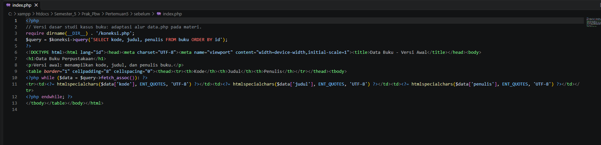
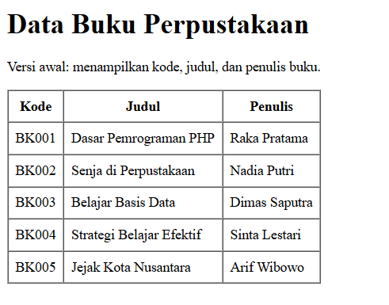
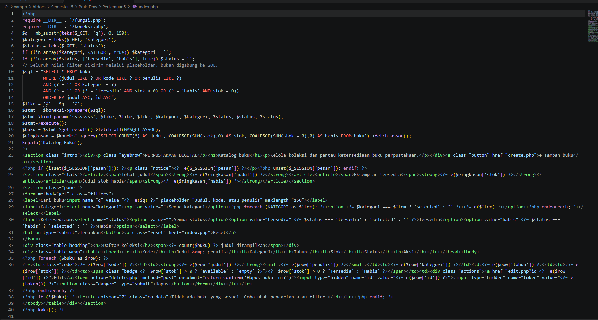
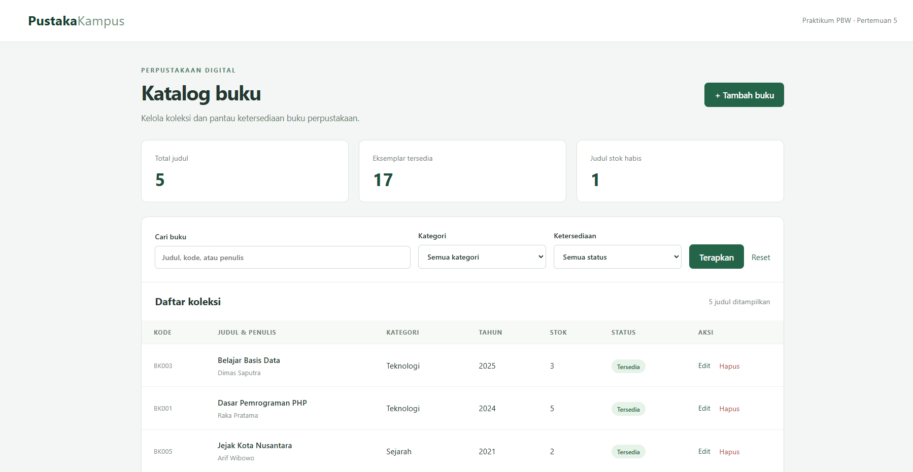
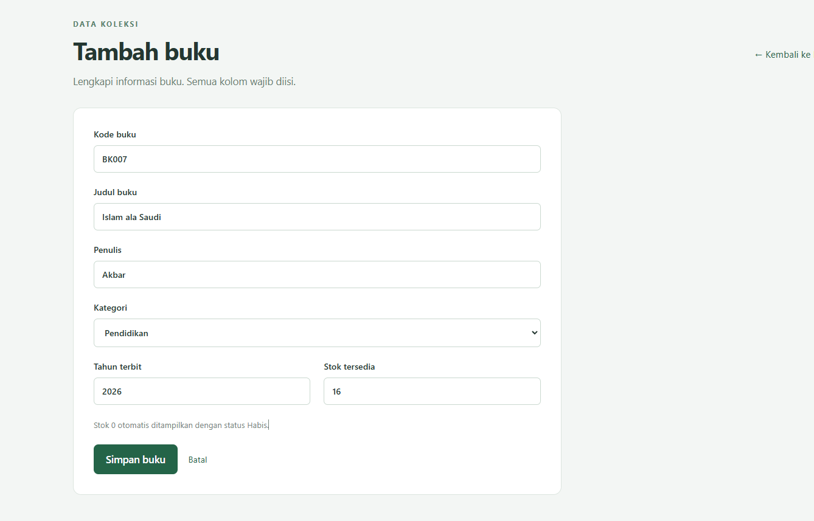
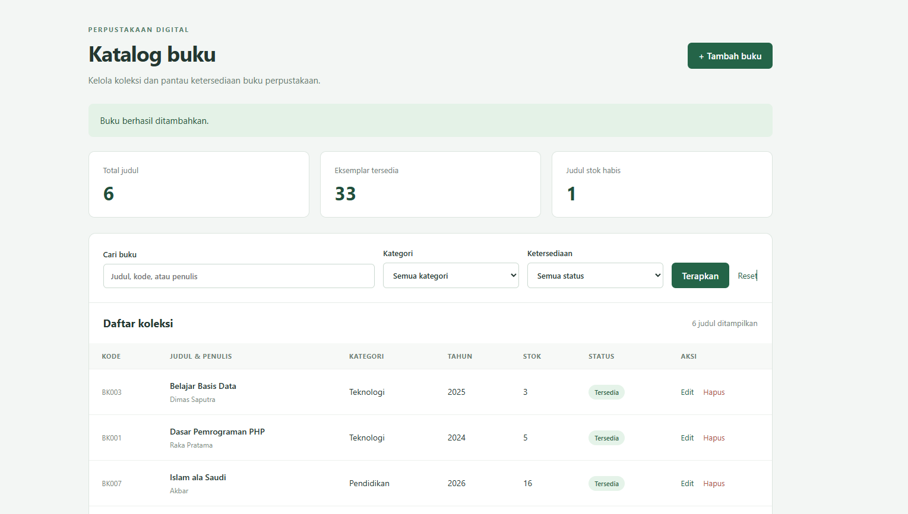
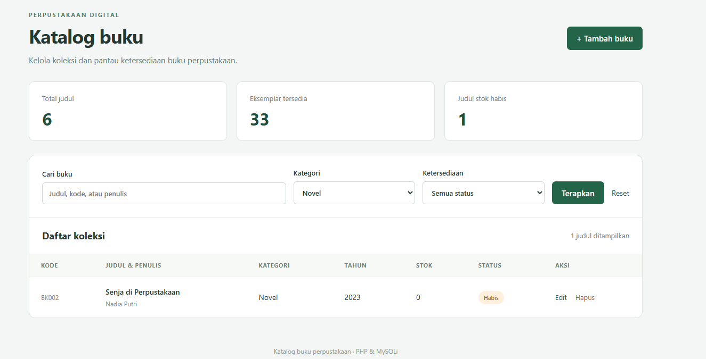
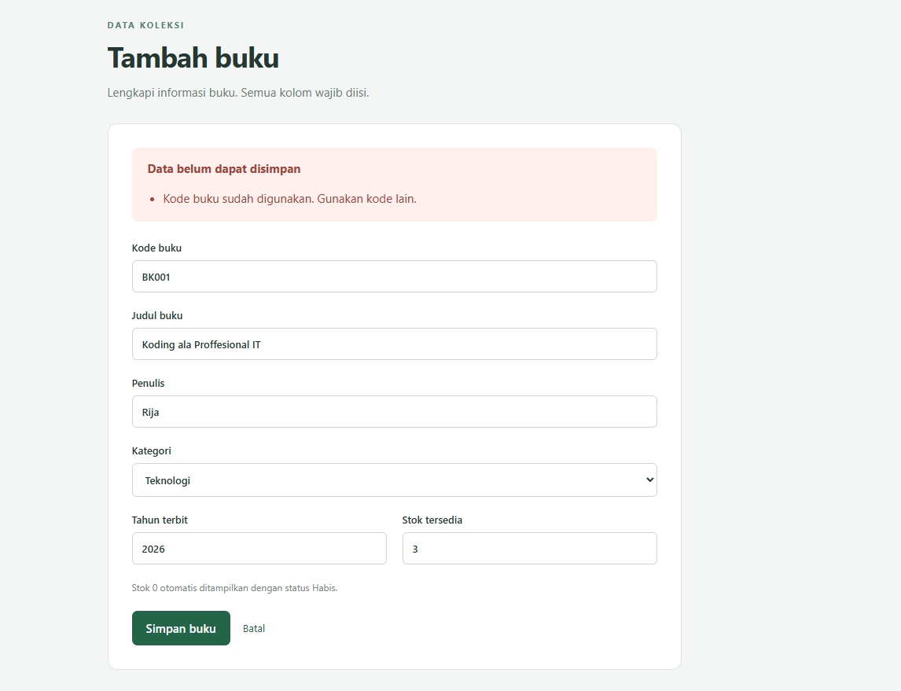
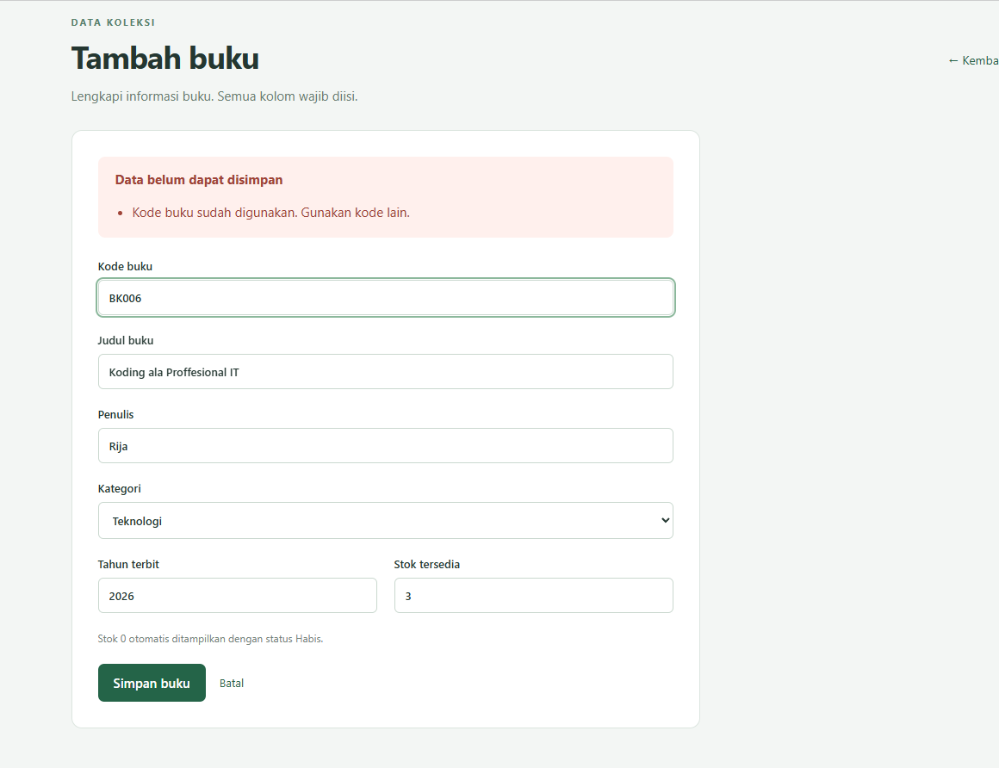
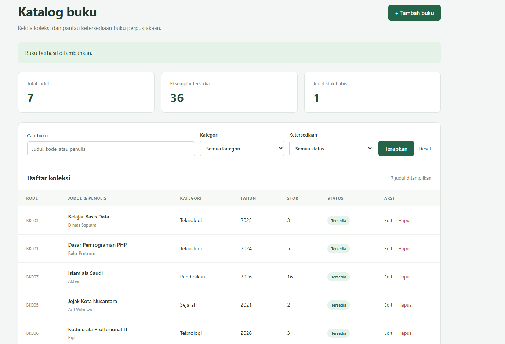

# Tugas 5 - Integrasi PHP MySQL dan CRUD Katalog Buku

## 1. Modifikasi Program

Praktikum menerapkan koneksi PHP–MySQL menggunakan MySQLi dengan studi kasus **katalog buku perpustakaan**. Contoh yang diberikan menggunakan data mahasiswa; pada tugas ini data diubah menjadi koleksi buku. Database `perpustakaan_pertemuan5` dipisahkan dari database praktikum sebelumnya.

Versi dasar pada `sebelum/index.php` mengadaptasi alur SELECT dan perulangan pada materi untuk menampilkan kode, judul, serta penulis buku. Versi ini dibuat sebagai pembanding awal studi kasus buku, bukan salinan identik contoh mahasiswa. ZIP contoh asli disimpan tanpa perubahan di `referensi/Pertemuan6ril.zip`.

Modifikasi yang diterapkan:

1. **Data koleksi lebih lengkap:** menambahkan kategori, tahun terbit, dan stok. Kondisi `stok > 0` menghasilkan status Tersedia, sedangkan stok 0 menghasilkan Habis.
2. **Query pencarian dan filter:** pencarian berdasarkan judul, kode, atau penulis; filter kategori dan ketersediaan dapat digunakan bersamaan. Hasil diurutkan menurut judul.
3. **Pengelolaan data:** tersedia formulir tambah dan edit, serta penghapusan melalui POST dengan konfirmasi. Setiap perubahan dibatasi berdasarkan ID buku.
4. **Validasi:** kode buku harus unik, tahun 1900 sampai tahun berjalan, dan stok harus bilangan bulat 0–999. Pesan kesalahan ditampilkan tanpa menghilangkan isian formulir.
5. **Tampilan:** tabel koleksi dilengkapi ringkasan jumlah judul, total stok, status ketersediaan, dan CSS lokal yang dapat digunakan tanpa CDN.

Prepared statements dan `htmlspecialchars()` dipertahankan dari pendekatan yang sudah ada dalam ZIP contoh; keduanya tidak diklaim sebagai fitur baru yang belum ada pada contoh.

## 2. Penjelasan 5 Bagian Kode Paling Penting

### 1. Koneksi database — `koneksi.php`

```php
$koneksi = new mysqli(
    getenv('PBW_DB_HOST') ?: '127.0.0.1',
    getenv('PBW_DB_USER') ?: 'root',
    getenv('PBW_DB_PASSWORD') ?: '',
    getenv('PBW_DB_NAME') ?: 'perpustakaan_pertemuan5',
    (int) (getenv('PBW_DB_PORT') ?: 3306)
);
$koneksi->set_charset('utf8mb4');
```

Koneksi menghubungkan PHP ke database perpustakaan. `utf8mb4` digunakan untuk menyimpan karakter Unicode. Penanganan exception memberikan pesan yang dapat dipahami ketika database belum tersedia.

### 2. Pencarian dan filter — `index.php`

```sql
SELECT * FROM buku
WHERE (judul LIKE ? OR kode LIKE ? OR penulis LIKE ?)
AND (? = '' OR kategori = ?)
AND (? = '' OR (? = 'tersedia' AND stok > 0) OR (? = 'habis' AND stok = 0))
ORDER BY judul ASC, id ASC
```

`LIKE` mencari kata pada tiga kolom. Kondisi kategori dan status mempersempit hasil hanya ketika filter dipilih. Nilai input diikat melalui `bind_param()` sehingga diperlakukan sebagai data, bukan perintah SQL.

### 3. Penambahan dan perubahan data — `store.php` dan `update.php`

```sql
INSERT INTO buku (kode, judul, penulis, kategori, tahun, stok)
VALUES (?, ?, ?, ?, ?, ?)

UPDATE buku SET kode = ?, judul = ?, penulis = ?, kategori = ?, tahun = ?, stok = ?
WHERE id = ?
```

INSERT menambah satu buku. UPDATE mengubah buku sesuai ID; kondisi WHERE mencegah seluruh koleksi ikut berubah. Setelah berhasil, redirect HTTP 303 mengarahkan pengguna ke katalog sehingga refresh halaman hasil tidak mengulangi pengiriman formulir.

### 4. Validasi dan penanganan duplikat — `fungsi.php` dan `store.php`

```php
if (filter_var($data['stok'], FILTER_VALIDATE_INT,
    ['options' => ['min_range' => 0, 'max_range' => 999]]) === false)
    $errors[] = 'Stok harus bilangan bulat 0–999.';

if ($error->getCode() === 1062)
    $errors[] = 'Kode buku sudah digunakan. Gunakan kode lain.';
```

Validasi server tetap bekerja ketika pemeriksaan browser dilewati. UNIQUE pada kolom kode menolak duplikasi di database; kode error 1062 kemudian diterjemahkan menjadi pesan pada formulir. Isian sebelumnya dipakai kembali agar pengguna cukup memperbaiki kolom yang salah.

### 5. Penampilan dan penghapusan data — `index.php` dan `delete.php`

```php
htmlspecialchars((string) $nilai, ENT_QUOTES, 'UTF-8');

$stmt = $koneksi->prepare('DELETE FROM buku WHERE id = ?');
$stmt->bind_param('i', $id);
$stmt->execute();
```

Data yang ditampilkan diubah menjadi teks HTML yang aman melalui fungsi `e()`. Penghapusan memerlukan POST dan token sesi yang valid, kemudian hanya menghapus ID yang diminta. `affected_rows` membedakan penghapusan berhasil dengan data yang tidak ditemukan.

## 3. Screenshot Sebelum dan Sesudah Modifikasi

Screenshot berikut memperlihatkan kode sebelum dan sesudah modifikasi, tampilan katalog, penambahan buku, filter kategori, serta penanganan kode buku duplikat.

### Kode Sebelum Modifikasi

Versi dasar pada `sebelum/index.php` menggunakan query `SELECT kode, judul, penulis FROM buku ORDER BY id`. Hasil query ditampilkan melalui perulangan `fetch_assoc()` dalam tabel tiga kolom, dengan `htmlspecialchars()` pada setiap nilai.



### Tampilan Sebelum Modifikasi

Tampilan awal berisi lima buku berkode BK001–BK005 dengan kolom kode, judul, dan penulis. Halaman masih menggunakan tabel sederhana tanpa pencarian, filter, ringkasan stok, atau tombol CRUD.



### Kode Sesudah Modifikasi

Kode `index.php` utama menambahkan pembacaan input pencarian dan filter, query dengan placeholder, `bind_param()`, serta pengambilan hasil query. Query ringkasan menghitung jumlah judul, total stok, dan jumlah judul yang stoknya habis. Bagian tampilan menyediakan formulir filter, tabel koleksi, serta aksi Edit dan Hapus.



### Tampilan Sesudah Modifikasi

Katalog menampilkan ringkasan **5 judul**, **17 eksemplar tersedia**, dan **1 judul stok habis**. Tampilan dilengkapi tombol Tambah buku, pencarian, filter kategori dan ketersediaan, serta tabel dengan informasi kategori, tahun, stok, status, dan aksi.



### Formulir Tambah Buku

Formulir diisi dengan kode **BK007**, judul **Islam ala Saudi**, penulis **Akbar**, kategori **Pendidikan**, tahun terbit **2026**, dan stok **16**. Isian tersebut merupakan data yang akan ditambahkan ke koleksi.



### Hasil Penambahan Buku

Setelah formulir disimpan, muncul pesan **“Buku berhasil ditambahkan.”** Buku Islam ala Saudi terlihat dalam tabel dengan kode BK007 dan stok 16. Jumlah koleksi bertambah dari **5 menjadi 6 judul**, sedangkan total stok bertambah dari **17 menjadi 33 eksemplar**. Jumlah judul dengan stok habis tetap satu.



### Hasil Filter Kategori Novel

Kategori dipilih **Novel**, sedangkan ketersediaan tetap **Semua status**. Hasilnya hanya satu judul, yaitu **Senja di Perpustakaan** berkode **BK002**, karya **Nadia Putri**, tahun **2023**, dengan stok **0** dan status **Habis**. Ringkasan di bagian atas tetap menunjukkan seluruh koleksi, yaitu enam judul dan 33 eksemplar; jumlah hasil pada tabel menjadi satu judul.



### Pesan Error Kode Duplikat

Penambahan buku **Koding ala Proffesional IT**, penulis **Rija**, kategori **Teknologi**, tahun **2026**, dan stok **3** menggunakan kode **BK001** yang sudah dipakai buku lain. Aplikasi menampilkan **“Data belum dapat disimpan”** dan **“Kode buku sudah digunakan. Gunakan kode lain.”** Semua isian formulir tetap dipertahankan.



### Perbaikan Kode Buku

Kode buku pada formulir diganti dari **BK001 menjadi BK006**, sedangkan judul, penulis, kategori, tahun, dan stok tetap sama. Screenshot diambil saat kode sudah diganti sebelum formulir dikirim ulang, sehingga pesan kesalahan dari pengiriman sebelumnya masih terlihat. Kolom yang diubah adalah **kode buku**, bukan ID internal database.



### Hasil Setelah Perbaikan Kode

Setelah disimpan ulang dengan kode BK006, muncul pesan **“Buku berhasil ditambahkan.”** Tabel memperlihatkan buku **Koding ala Proffesional IT** karya Rija dengan stok tiga dan status Tersedia. Total koleksi menjadi **7 judul** dan **36 eksemplar**, sedangkan jumlah judul stok habis tetap satu. Penambahan berhasil tanpa mengubah buku BK001 yang sudah ada.



## 4. Error yang Muncul, Penyebab, dan Perbaikan

Error terjadi ketika buku **Koding ala Proffesional IT** ditambahkan menggunakan kode **BK001**. Kode tersebut sudah digunakan oleh **Dasar Pemrograman PHP**, sehingga penyimpanan ditolak oleh constraint UNIQUE pada kolom `kode`. Pada tingkat database, pelanggaran ini menghasilkan **error 1062 (Duplicate entry)**.

Program menangkap `mysqli_sql_exception`, memeriksa kode error 1062, kemudian menampilkan pesan **“Kode buku sudah digunakan. Gunakan kode lain.”** pada formulir dengan respons HTTP 422. Screenshot memperlihatkan pesan tersebut beserta isian yang tetap terjaga; kode error database dan status HTTP merupakan detail penanganan program, bukan teks yang ditampilkan pada screenshot.

Perbaikan dilakukan dengan mengganti kode **BK001 menjadi BK006** dan menyimpan ulang formulir. Screenshot hasil memperlihatkan pesan berhasil, baris buku BK006, serta kenaikan koleksi dari **6 judul/33 eksemplar menjadi 7 judul/36 eksemplar**. Dengan demikian, data baru dapat disimpan setelah kode unik digunakan.

## 5. Validasi Hasil

Pengujian menggunakan PHP 8.2.12 dan MariaDB 10.4.32 pada server lokal sementara yang terpisah dari database XAMPP utama. Semua sepuluh file PHP lolos pemeriksaan sintaks. Sebanyak **19 pemeriksaan HTTP berhasil**, meliputi baca data, pencarian, filter gabungan, tambah, edit, hapus, penolakan stok negatif dan tahun tidak valid, kode duplikat, token salah, ID tidak ditemukan, serta penampilan teks HTML secara aman. Rincian terdapat pada `VALIDASI.txt`.

Pada pengujian terpisah tersebut, data uji CRUD telah dihapus dan kondisi akhir database uji kembali menjadi lima judul dengan total stok 17. Hasil ini berbeda dari kondisi pada screenshot praktikum, yang memperlihatkan penambahan dua buku hingga menjadi tujuh judul dan 36 eksemplar.

Sepuluh screenshot praktikum mendokumentasikan kode sebelum dan sesudah modifikasi, tampilan katalog, formulir dan hasil penambahan, filter kategori Novel, penolakan kode duplikat, serta keberhasilan setelah kode diperbaiki. Jumlah stok pada gambar konsisten: `17 + 16 = 33`, kemudian `33 + 3 = 36`. Screenshot tersebut mendukung hasil penambahan, filter, dan penanganan duplikat; pengujian edit dan hapus tercatat secara terpisah pada `VALIDASI.txt`.

Validasi database mencakup UNIQUE kode, kategori ENUM, serta batas tahun 1900–2100 dan stok 0–999. Aplikasi menerapkan batas tahun yang lebih ketat, yaitu sampai tahun berjalan. Pengaturan ini tidak menimpa database akademik dari pertemuan sebelumnya.

## Referensi

- Materi praktikum yang diberikan: *Prak PBW ruangan AI pertemuan 5 dan 6.pdf*. Label internal slide masih tertulis Pertemuan 4; tugas disimpan pada Pertemuan5 sesuai permintaan.
- Contoh program: `referensi/Pertemuan6ril.zip`.
- [PHP Manual — MySQLi Prepared Statements](https://www.php.net/manual/en/mysqli.quickstart.prepared-statements.php).
- [PHP Manual — htmlspecialchars](https://www.php.net/manual/en/function.htmlspecialchars.php).
