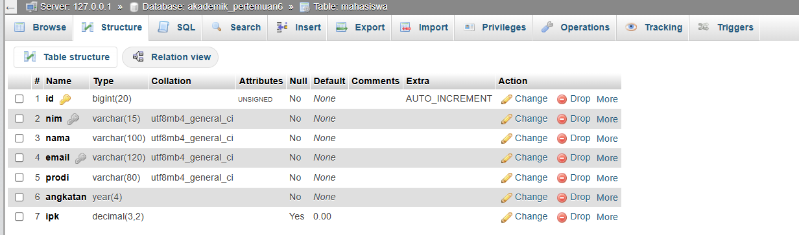
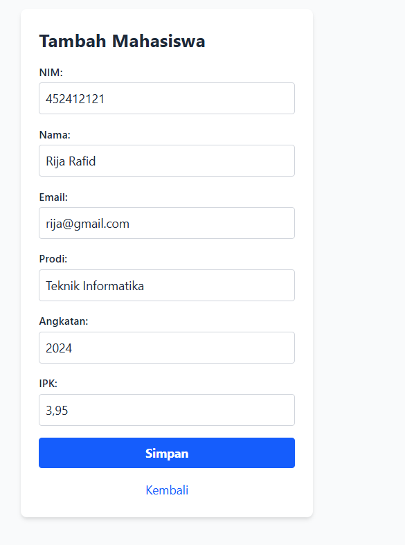
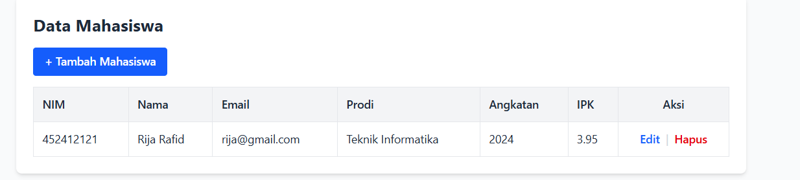
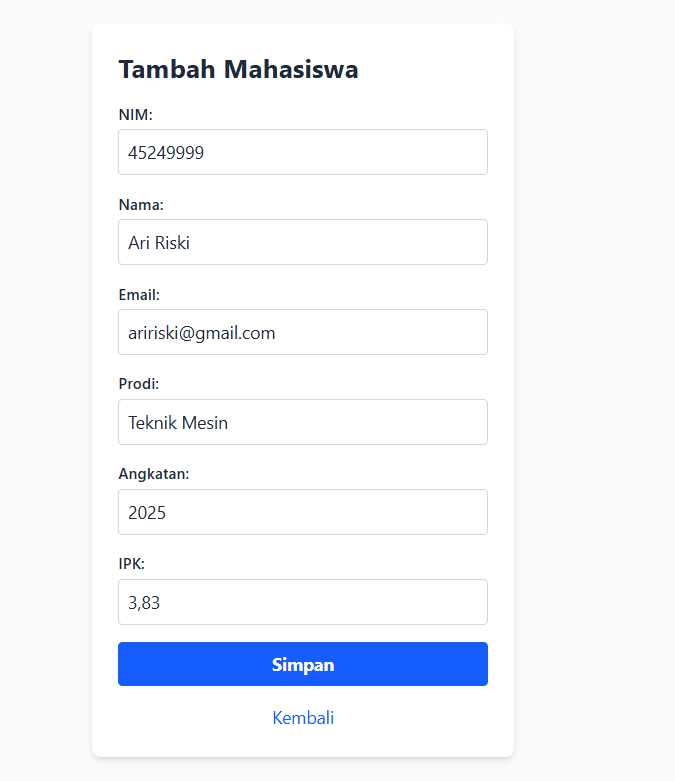
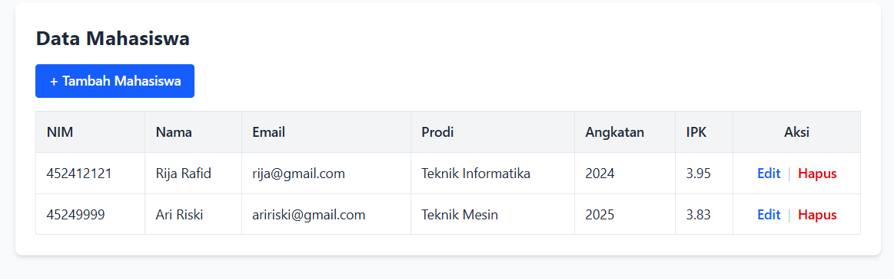
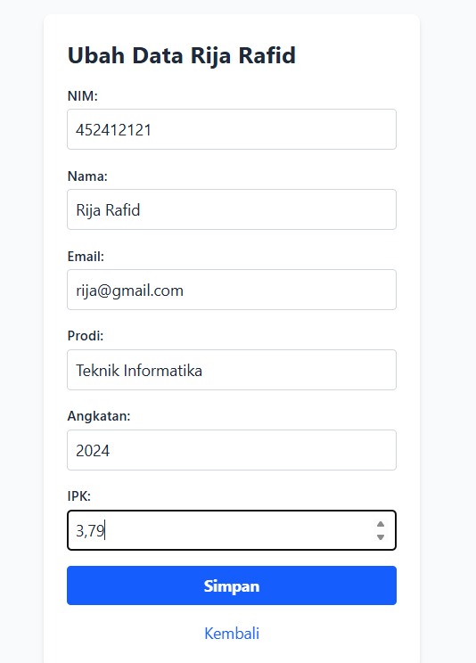
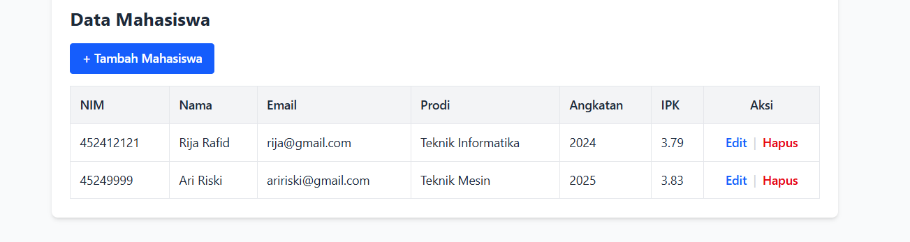
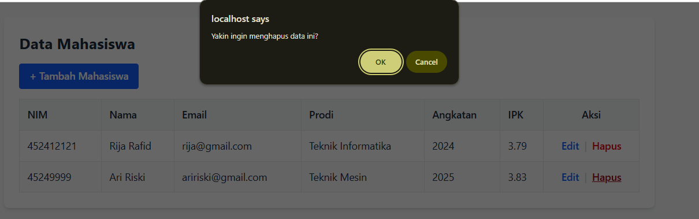
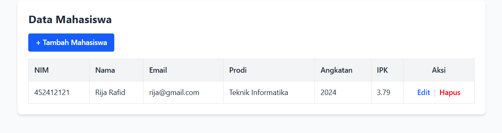

# Tugas 6 - Pengolahan Data Mahasiswa dengan PHP dan MySQL

## 1. Pembuatan Aplikasi Pengolahan Data Mahasiswa

Praktikum ini menggunakan PHP dan MySQL melalui ekstensi MySQLi untuk mengelola data mahasiswa pada database `akademik_pertemuan6`. Data yang diolah meliputi NIM, nama, email, program studi, angkatan, dan IPK.

Alur CRUD menggunakan `index.php` sebagai halaman tabel, `create.php` dan `store.php` untuk menambahkan mahasiswa, `edit.php` dan `update.php` untuk mengubah data, serta `delete.php` untuk menghapus data. Tampilan CRUD menggunakan Tailwind CSS melalui CDN. File latihan dasar `form.php`, `simpan.php`, dan `data.php` juga tersedia, tetapi screenshot laporan ini mendokumentasikan alur CRUD.

File `koneksi.php` menyediakan koneksi database dan pengaturan karakter `utf8mb4`. File `akademik.sql` memuat struktur tabel `mahasiswa`, `dosen`, dan `mata_kuliah`, beserta dua data awal mahasiswa. Operasi CRUD dalam aplikasi berfokus pada tabel `mahasiswa`.

## 2. Penjelasan 5 Bagian Kode Paling Penting

1. **Koneksi database pada `koneksi.php`.** `mysqli_connect()` menghubungkan PHP dengan database `akademik_pertemuan6`. Kegagalan koneksi menghasilkan status HTTP 500 dan pesan kesalahan. `mysqli_set_charset()` mengatur koneksi menggunakan `utf8mb4`.
2. **Pembacaan dan penampilan data pada `index.php` dan `data.php`.** Query `SELECT * FROM mahasiswa` mengambil data, kemudian `mysqli_fetch_assoc()` membaca setiap baris. `index.php` menampilkannya dalam tabel dengan tautan Edit dan Hapus, sedangkan `data.php` menampilkan NIM dan nama. `htmlspecialchars(..., ENT_QUOTES, 'UTF-8')` mengubah karakter khusus menjadi entitas HTML saat ditampilkan.
3. **Validasi dan penambahan data pada `simpan.php` dan `store.php`.** Kedua file menerima metode POST, memeriksa seluruh kolom wajib, memangkas spasi, serta memvalidasi email, angka angkatan, dan IPK 0–4. Query `INSERT INTO mahasiswa (...) VALUES (?, ?, ?, ?, ?, ?)` menggunakan prepared statement dan `mysqli_stmt_bind_param()` untuk mengikat nilai input. `simpan.php` menampilkan pesan dan tautan, sedangkan `store.php` menampilkan alert lalu mengarahkan pengguna ke tabel jika berhasil.
4. **Pengambilan dan perubahan data pada `edit.php` dan `update.php`.** `edit.php` mengambil mahasiswa berdasarkan parameter NIM menggunakan `WHERE nim = ?`, lalu mengisi form dengan data tersebut. NIM ditampilkan sebagai input readonly. Setelah validasi, `update.php` memperbarui nama, email, prodi, angkatan, dan IPK menggunakan NIM sebagai kondisi pencarian.
5. **Konfirmasi dan penghapusan pada `index.php` dan `delete.php`.** Tautan Hapus menjalankan `confirm()` sebelum membuka `delete.php?nim=...`. Query `DELETE FROM mahasiswa WHERE nim = ?` menghapus data berdasarkan NIM. `mysqli_stmt_affected_rows()` memeriksa apakah ada baris yang terhapus sebelum menampilkan pesan berhasil.

## 3. Screenshot Hasil Praktikum

Screenshot berikut merupakan capture hasil praktikum yang memperlihatkan struktur tabel, penambahan data Rija Rafid dan Ari Riski, perubahan IPK Rija Rafid, serta penghapusan Ari Riski.

### Struktur Tabel Mahasiswa

Tabel `mahasiswa` memiliki kolom `id`, `nim`, `nama`, `email`, `prodi`, `angkatan`, dan `ipk`. Kolom `id` menjadi primary key dengan AUTO_INCREMENT, sedangkan NIM dan email memiliki indeks UNIQUE.

### Form Tambah Data Awal

Form `create.php` diisi dengan NIM `452412121`, nama Rija Rafid, email `rija@gmail.com`, prodi Teknik Informatika, angkatan 2024, dan IPK 3.95 sebelum disimpan.

### Notifikasi Penyimpanan Berhasil

Browser menampilkan alert “Data mahasiswa berhasil disimpan” setelah proses penyimpanan. Keberadaan data yang tersimpan terlihat pada tabel di screenshot berikutnya.

### Tabel Data Mahasiswa

Halaman `index.php` menampilkan satu baris data Rija Rafid dengan NIM `452412121` dan IPK 3.95. Seluruh kolom data, tombol Tambah Mahasiswa, serta tautan Edit dan Hapus terlihat pada tabel.

### Form Tambah Mahasiswa

Form `create.php` kemudian diisi dengan NIM `45249999`, nama Ari Riski, email `aririski@gmail.com`, prodi Teknik Mesin, angkatan 2025, dan IPK 3.83. Data dikirimkan ke `store.php` untuk divalidasi dan disimpan.

### Hasil Penambahan Mahasiswa

Tabel menampilkan dua mahasiswa setelah penambahan: Rija Rafid dengan IPK 3.95 dan Ari Riski dengan IPK 3.83. Baris baru Ari Riski menunjukkan hasil penambahan data.

### Form Edit Mahasiswa

Form `edit.php` memuat data Rija Rafid. Nilai IPK diubah dari 3.95 menjadi 3.79 sebelum disimpan, sedangkan NIM `452412121` dan kolom lainnya tetap sama.

### Hasil Perubahan Mahasiswa

Setelah perubahan disimpan, IPK Rija Rafid pada tabel menjadi 3.79. Data Ari Riski tetap tersedia dengan IPK 3.83.

### Konfirmasi Penghapusan

Ketika tautan Hapus pada baris Ari Riski dipilih, browser menampilkan dialog “Yakin ingin menghapus data ini?”. Screenshot memperlihatkan dialog beserta dua baris data sebelum penghapusan dilanjutkan.

### Hasil Penghapusan Mahasiswa

Setelah penghapusan, baris Ari Riski tidak lagi muncul. Tabel hanya menampilkan Rija Rafid dengan IPK 3.79, sehingga hasil perubahan sebelumnya tetap tersimpan.

## 4. Validasi Program

Pemeriksaan sintaks menggunakan PHP pada XAMPP berhasil untuk seluruh 10 file PHP tanpa kesalahan sintaks. Pemeriksaan sumber juga menunjukkan penggunaan prepared statement untuk input pada INSERT, pencarian edit, UPDATE, dan DELETE; escaping HTML saat menampilkan data; serta validasi input pada proses penyimpanan dan perubahan.

Database menetapkan NIM dan email sebagai nilai unik. Batas IPK 0–4 diterapkan pada form serta kode PHP; dump SQL tidak memiliki CHECK untuk rentang IPK. Kolom angkatan menggunakan tipe YEAR, sehingga validasi angka 1900–9999 pada PHP tidak menjamin seluruh rentang tersebut dapat disimpan oleh database.

Screenshot pengguna memperlihatkan keberhasilan penambahan, penampilan, perubahan IPK, dan penghapusan data pada alur CRUD. Struktur tabel pada phpMyAdmin dan nama database `akademik_pertemuan6` sesuai dengan konfigurasi koneksi saat diperiksa. Bukti ini mencakup alur berhasil; pengujian penolakan input tidak valid, data duplikat, dan alur form dasar belum didokumentasikan dengan screenshot.

Referensi penjelasan fungsi: [PHP Manual — mysqli_prepare](https://www.php.net/manual/en/mysqli.prepare.php) dan [PHP Manual — htmlspecialchars](https://www.php.net/manual/en/function.htmlspecialchars.php).
