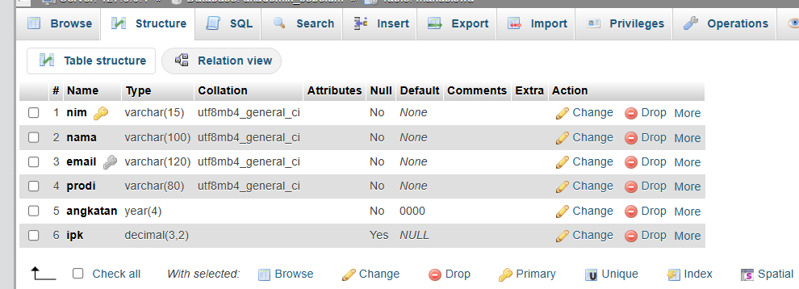
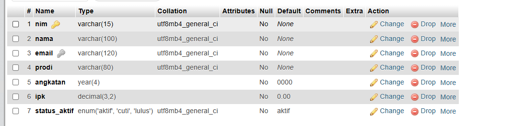

# Tugas 3 - Modifikasi Database Akademik

## 1. Modifikasi SQL

Database akademik pada `Pertemuan3_awal.sql` terdiri dari tabel `mahasiswa`, `dosen`, `mata_kuliah`, dan `krs`. Hasil modifikasi disimpan dalam `Pertemuan3_modifikasi.sql` dengan beberapa perubahan:

1. **Status mahasiswa:** menambahkan kolom `status_aktif` dengan pilihan `aktif`, `cuti`, atau `lulus` dan nilai default `aktif`.
2. **Pengaturan IPK:** mengubah kolom `ipk` menjadi `NOT NULL DEFAULT 0.00` serta mempertahankan batas IPK 0.00–4.00 yang sudah ada pada SQL awal.
3. **Validasi semester:** menambahkan constraint `chk_krs_semester` untuk membatasi semester KRS dari 1 sampai 8.
4. **Data dan query:** menambahkan contoh data dosen, mata kuliah, dan KRS, serta query untuk menampilkan mahasiswa aktif berdasarkan IPK dan menggabungkan data dari keempat tabel.

Hasil modifikasi menggunakan database `akademik_pertemuan3` agar terpisah dari database awal. Primary key, foreign key, dan unique key gabungan KRS yang sudah ada tetap dipertahankan.

## 2. Penjelasan 5 Bagian Kode Paling Penting

1. `CREATE DATABASE IF NOT EXISTS` dan `USE` menyiapkan serta memilih database `akademik_pertemuan3` sebagai tempat penyimpanan tabel dan data hasil modifikasi.
2. `status_aktif ENUM('aktif','cuti','lulus') NOT NULL DEFAULT 'aktif'` menyediakan pilihan status mahasiswa dan memberi nilai `aktif` jika status tidak dicantumkan saat memasukkan data.
3. `ipk DECIMAL(3,2) NOT NULL DEFAULT 0.00` mengatur IPK menjadi angka dengan dua digit desimal, tidak menerima `NULL`, dan menggunakan nilai 0.00 jika kolom tidak dicantumkan saat memasukkan data.
4. `CHECK` pada `chk_mahasiswa_ipk` dan `chk_krs_semester` membatasi IPK ke rentang 0.00–4.00 serta semester ke rentang 1–8.
5. `SELECT` bersama `WHERE` dan `ORDER BY` menampilkan mahasiswa aktif berdasarkan IPK tertinggi. Query berikutnya menggunakan `JOIN` dan `LEFT JOIN` untuk menampilkan KRS beserta nama mahasiswa, mata kuliah, dan dosen.

## 3. Screenshot Sebelum dan Sesudah Modifikasi

Screenshot berikut menunjukkan struktur tabel `mahasiswa` di phpMyAdmin sebelum dan sesudah modifikasi, berdasarkan `Pertemuan3_awal.sql` dan `Pertemuan3_modifikasi.sql`.

### Struktur Tabel Sebelum Modifikasi

Database `akademik_sebelum` belum memiliki kolom `status_aktif`, dan kolom `ipk` masih menerima `NULL`.

### Struktur Tabel Sesudah Modifikasi

Database `akademik_pertemuan3` memiliki kolom `status_aktif` dengan nilai default `aktif`, sedangkan kolom `ipk` menjadi `NOT NULL` dengan nilai default 0.00.

## 4. Validasi Data Akademik

Kolom `ipk` tidak menerima `NULL` dan dibatasi antara 0.00–4.00, sedangkan semester KRS dibatasi antara 1–8 melalui `CHECK`. Kolom `status_aktif` menyediakan pilihan `aktif`, `cuti`, dan `lulus` melalui `ENUM`. Pada mode SQL non-strict seperti dalam file ini, nilai `ENUM` di luar daftar dapat dikonversi menjadi string kosong dengan peringatan, sehingga tidak selalu ditolak sebagai error.

Foreign key menjaga agar data KRS merujuk mahasiswa dan mata kuliah yang terdaftar. Unique key `uq_krs` mencegah pengulangan kombinasi NIM, kode mata kuliah, semester, dan tahun ajaran yang sama.

Referensi: [constraint MariaDB](https://mariadb.com/docs/server/reference/sql-statements/data-definition/constraint) dan [tipe data ENUM](https://mariadb.com/docs/server/reference/data-types/string-data-types/enum).

## Menjalankan SQL

1. Buka **XAMPP Control Panel**, lalu jalankan **Apache** dan **MySQL**.
2. Buka [phpMyAdmin](http://localhost/phpmyadmin) di browser.
3. Untuk menyiapkan database awal, buat database kosong bernama `akademik_sebelum`, pilih database tersebut, lalu buka tab **Import** dan impor `Pertemuan3_awal.sql`. File awal tidak memiliki perintah `CREATE DATABASE` atau `USE`, sehingga database harus dipilih terlebih dahulu.
4. Untuk hasil modifikasi, kembali ke halaman utama phpMyAdmin, buka tab **Import**, lalu impor `Pertemuan3_modifikasi.sql`. File ini membuat dan memilih database `akademik_pertemuan3` secara otomatis.
5. Buka tabel `mahasiswa` pada masing-masing database dan pilih tab **Structure/Struktur** untuk melihat perbedaannya. Query contoh di bagian akhir file modifikasi dapat dijalankan ulang melalui tab **SQL**.

Gunakan database kosong untuk impor pertama. `CREATE TABLE IF NOT EXISTS` tidak memperbarui struktur tabel yang sudah ada, sehingga mengimpor ulang file modifikasi bukan pengganti perubahan struktur dengan `ALTER TABLE`.
