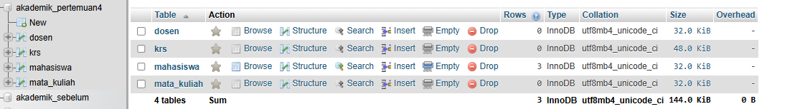
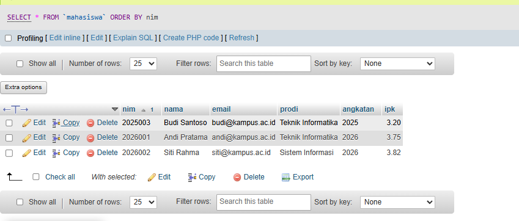
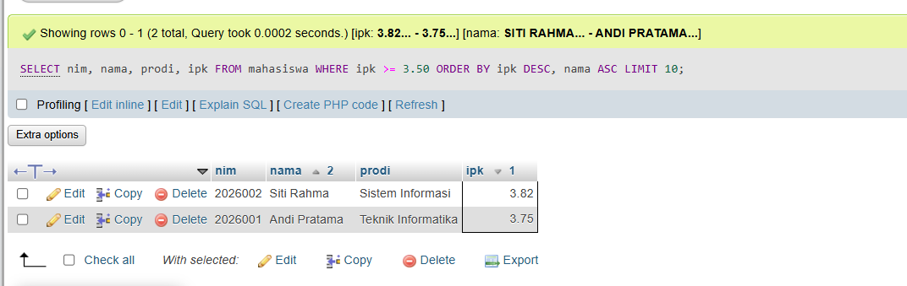
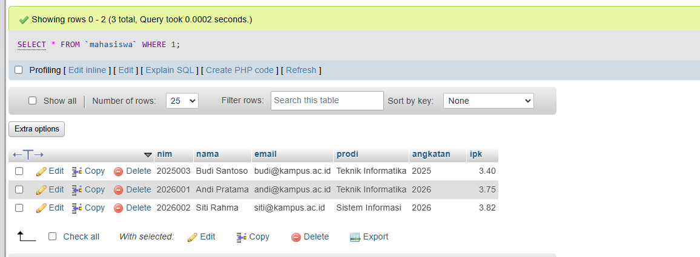
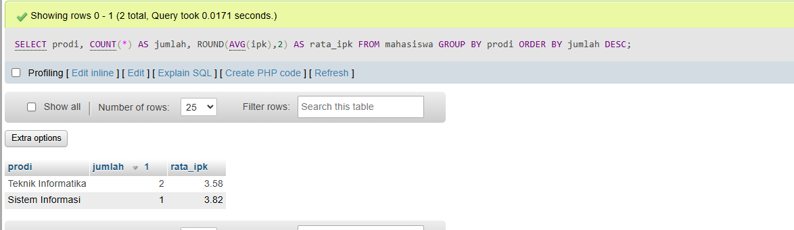
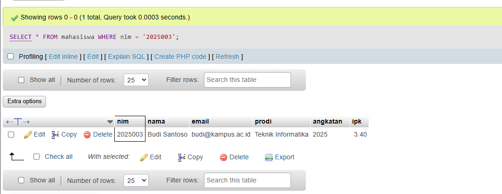
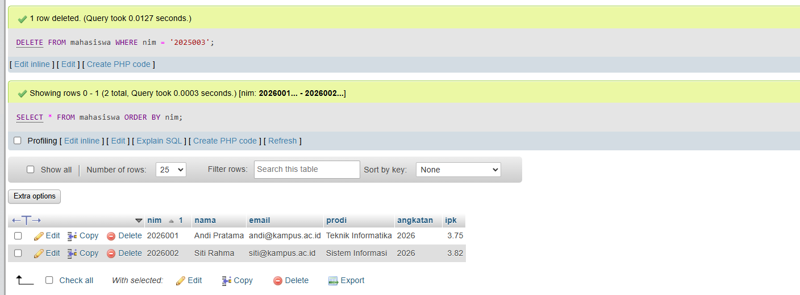

# Tugas 4 - Database MySQL dan Query Dasar

## 1. Pembuatan Database dan Pengolahan Data

Latihan pada PPT Pertemuan 3 dan 4 dikerjakan menggunakan SQL melalui phpMyAdmin pada XAMPP. Database diberi nama `akademik_pertemuan4` agar terpisah dari database praktikum sebelumnya. Pengerjaan terdiri dari empat bagian:

1. **Struktur Kode Program A:** membuat tabel `mahasiswa`, `dosen`, dan `mata_kuliah` pada `01_struktur_A.sql`.
2. **Struktur Kode Program B:** membuat tabel `krs` beserta foreign key dan unique key gabungan pada `02_struktur_B.sql`.
3. **Query Kode Program A:** menambahkan tiga mahasiswa, kemudian menampilkan mahasiswa dengan IPK minimal 3.50 menggunakan WHERE, ORDER BY, dan LIMIT pada `03_query_A.sql`.
4. **Query Kode Program B:** mengubah IPK Budi, membuat rekap per program studi, memverifikasi target penghapusan, lalu menghapus data Budi pada `04_query_B.sql`.

## 2. Penjelasan 5 Bagian Kode Paling Penting

1. `CREATE TABLE` membentuk struktur tabel dan tipe data. PRIMARY KEY pada `nim`, `nidn`, dan `kode_mk` menjadi identitas unik, sedangkan `krs.id` menggunakan AUTO_INCREMENT.
2. `FOREIGN KEY` menghubungkan `mata_kuliah.nidn` dengan `dosen.nidn`, `krs.nim` dengan `mahasiswa.nim`, serta `krs.kode_mk` dengan `mata_kuliah.kode_mk` agar data referensi tetap konsisten.
3. `SELECT ... WHERE ipk >= 3.50 ORDER BY ipk DESC, nama ASC LIMIT 10` menyaring mahasiswa berdasarkan IPK, mengurutkan hasil dari IPK tertinggi, dan membatasi hasil maksimal sepuluh baris.
4. `UPDATE mahasiswa SET ipk = 3.40 WHERE nim = '2025003'` mengubah IPK Budi Santoso saja. `GROUP BY prodi`, `COUNT(*)`, dan `ROUND(AVG(ipk),2)` kemudian menghasilkan jumlah mahasiswa serta rata-rata IPK per program studi.
5. `SELECT * FROM mahasiswa WHERE nim = '2025003'` memverifikasi data Budi sebelum `DELETE` dijalankan. Kondisi WHERE membatasi penghapusan pada NIM tersebut.

## 3. Screenshot Hasil Praktikum

Screenshot berikut menunjukkan struktur database dan hasil setiap tahap pengolahan data mahasiswa melalui phpMyAdmin.

### Struktur Database

Database `akademik_pertemuan4` memiliki empat tabel, yaitu `mahasiswa`, `dosen`, `mata_kuliah`, dan `krs`. Pada screenshot ini, tiga data mahasiswa sudah dimasukkan.

### Data Awal Mahasiswa

Setelah INSERT, tabel berisi Budi Santoso dengan IPK 3.20, Andi Pratama dengan IPK 3.75, dan Siti Rahma dengan IPK 3.82. Data ditampilkan sebelum perubahan IPK dan penghapusan.

### Hasil Filter Mahasiswa

Filter IPK minimal 3.50 menghasilkan Siti Rahma terlebih dahulu, kemudian Andi Pratama. Budi tidak ditampilkan karena IPK awalnya 3.20.

### Data Sesudah UPDATE

IPK Budi Santoso berubah dari 3.20 menjadi 3.40. Jumlah mahasiswa tetap tiga dan data Andi serta Siti tidak berubah.

### Rekap Mahasiswa per Program Studi

Teknik Informatika memiliki dua mahasiswa dengan rata-rata IPK 3.58, sedangkan Sistem Informasi memiliki satu mahasiswa dengan rata-rata IPK 3.82. Rekap dibuat setelah UPDATE dan sebelum DELETE. Rata-rata Teknik Informatika diperoleh dari `(3.75 + 3.40) / 2 = 3.575`, kemudian dibulatkan menjadi 3.58.

### Verifikasi Data Sebelum DELETE

Pencarian berdasarkan NIM `2025003` menampilkan satu baris data Budi Santoso dengan IPK 3.40 sebagai target penghapusan.

### Data Sesudah DELETE

phpMyAdmin menampilkan pesan **1 row deleted**. Budi Santoso sudah dihapus sehingga tabel mahasiswa hanya berisi Andi Pratama dan Siti Rahma.

## 4. Validasi Data

Constraint `CHECK (ipk BETWEEN 0.00 AND 4.00)` membatasi IPK numerik pada rentang 0.00–4.00. Sesuai struktur latihan, kolom IPK tidak diberi NOT NULL sehingga nilai NULL masih diperbolehkan. PRIMARY KEY mencegah identitas ganda, UNIQUE mencegah email duplikat, dan FOREIGN KEY menjaga referensi antar tabel. Unique key gabungan pada `krs` mencegah mahasiswa mengambil mata kuliah yang sama pada semester dan tahun ajaran yang sama.

Pengujian SQL pada MariaDB 10.4.32 dalam database uji terpisah menunjukkan bahwa IPK 4.50, NIM duplikat, serta KRS dengan referensi mahasiswa yang tidak tersedia ditolak. Hasil pengujian dicatat dalam `VALIDASI.txt`. Screenshot praktikum memperlihatkan hasil INSERT, filter, UPDATE, rekapitulasi, verifikasi, dan DELETE sesuai latihan.
